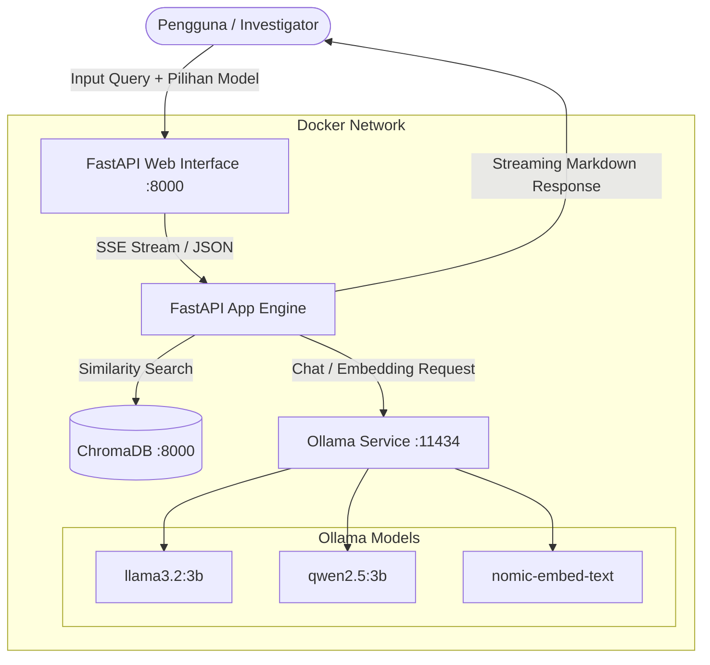

# 🔍 S.O.N.A.R — Social Online Network Analytics & Response

<p align="center">
  
  
  
  
  
  
</p>

---

## 📖 Tentang Proyek

**S.O.N.A.R** (*Social Online Network Analytics & Response*) adalah sistem asisten AI berbasis **Retrieval-Augmented Generation (RAG)** dan **Multi-Model LLM** untuk investigasi mendalam akar penyebab (*root cause*) perubahan sentimen publik di media sosial.

Sistem ini membantu *public relations*, analis komunikasi, dan tim teknis untuk mengidentifikasi pemicu keluhan massal (misal: kendala transaksi QRIS, bug update aplikasi, lambatnya respons customer service) serta merumuskan strategi penanganan dan komunikasi krisis secara objektif berbasis data empiris.

---

## ✨ Fitur Unggulan

- 🎨 **Modern Conversational UI (Gemini / ChatGPT Aesthetic):** Tampilan *dark mode* bersih (`#131314`), floating input dock auto-resize, serta micro-interactions setara Claude dan Gemini.
- 🔄 **Dynamic Multi-Model Switcher:** Beralih model LLM secara instan di antarmuka web antara **Meta Llama 3.2 (3B)** dan **Qwen 2.5 (3B)** tanpa perlu me-restart server.
- ⚡ **Real-Time SSE Streaming & Stop Generation:** Respons dialirkan per token secara halus dengan dukungan tombol pembatalan (`■ Stop Generating`) berbasis `AbortController`.
- 🧠 **ChromaDB Vector Store Retrieval:** Pencarian semantik dokumen keluhan netizen menggunakan model representasi semantik `nomic-embed-text`.
- 📝 **Markdown & Code Highlighting:** Render otomatis tabel, list, kutipan, dan blok kode dengan tombol *"Salin Kode"* sekali klik.
- 🗂️ **Session History (LocalStorage):** Riwayat sesi percakapan otomatis tersimpan di peramban pengguna, lengkap dengan tombol `+ Obrolan Baru` dan hapus sesi.
- 🐳 **Full Containerization:** Orkestrasi terpadu multi-container via Docker Compose (Ollama, ChromaDB, dan FastAPI).

---

## 🏛️ Arsitektur Sistem



---

## 📁 Struktur Direktori

```text
├── app/
│   ├── __init__.py
│   └── main.py                     # Backend FastAPI, API endpoints, & Single-File Modern Web UI
├── data/
│   └── social_media_comments.csv   # Dataset komentar media sosial (Twitter/X, IG, TikTok, YouTube)
├── app.py                          # Antarmuka eksploratif alternatif (Streamlit RAG Dashboard)
├── ingest.py                       # Script indexing dataset CSV ke ChromaDB Vector Store
├── docker-compose.yml              # Konfigurasi orkestrasi Docker (ollama, chromadb, api)
├── Dockerfile                      # Definisi container image backend FastAPI
├── requirements.txt                # Dependensi pustaka Python
├── Modelfile                       # Blueprint kustomisasi persona Ollama
├── prompt_agentic_rag_s_o_n_a_r.md # Spesifikasi arsitektur Agentic RAG S.O.N.A.R
├── prompt_redesign_ui_modern_ai.md # Spesifikasi desain antarmuka modern AI
└── README.md                       # Dokumentasi resmi proyek
```

---

## 🚀 Panduan Instalasi & Menjalankan (Docker)

Metode termudah dan direkomendasikan adalah menggunakan **Docker Compose**.

### 1. Prasyarat
Pastikan sistem Anda telah terpasang:
- [Docker Desktop](https://www.docker.com/products/docker-desktop/) (dengan engine Linux containers aktif)
- [Git](https://git-scm.com/)
- RAM minimal 8 GB disarankan untuk menjalankan model 3B

---

### 2. Clone Repository
```bash
git clone https://github.com/Danzyyyy/S.O.N.A.R.git
cd S.O.N.A.R
```

---

### 3. Jalankan Docker Compose
Bangun dan jalankan semua container di latar belakang:
```bash
docker compose up -d --build
```

Periksa status container:
```bash
docker compose ps
```
Pastikan ketiga service berstatus `Up`:
- `fastapi_app` (Port `8000`)
- `chroma_vector_store` (Port `8001:8000`)
- `ollama_service` (Port `11434`)

---

### 4. Unduh Model LLM & Embedding ke Ollama
Jalankan perintah berikut untuk mengunduh model yang dibutuhkan ke dalam container Ollama:

```bash
# Model Chat 1: Meta Llama 3.2 (3B)
docker exec -it ollama_service ollama pull llama3.2:3b

# Model Chat 2: Alibaba Qwen 2.5 (3B)
docker exec -it ollama_service ollama pull qwen2.5:3b

# Model Embeddings untuk Vector Search
docker exec -it ollama_service ollama pull nomic-embed-text
```

---

### 5. Lakukan Ingest Dataset ke ChromaDB
Indeks seluruh data komentar media sosial ke dalam ChromaDB:

```bash
docker exec -it fastapi_app python ingest.py
```

*Output yang diharapkan:*
```text
[Ingest] Menghubungkan ke ChromaDB di chromadb:8000...
[Ingest] Membaca dataset dari data/social_media_comments.csv...
[Ingest] Menginisialisasi embeddings (nomic-embed-text) via http://ollama:11434...
[Ingest] Menyimpan 30 dokumen ke ChromaDB...
[Ingest] Sukses melakukan indexing 30 dokumen!
Selesai! Total dokumen terindeks: 30
```

---

### 6. Akses Aplikasi
Buka peramban (browser) dan akses tautan berikut:
- **Web Chatbot UI:** [http://localhost:8000](http://localhost:8000)
- **Dokumentasi API Interaktif (Swagger UI):** [http://localhost:8000/docs](http://localhost:8000/docs)
- **Status Kesehatan Sistem:** [http://localhost:8000/health](http://localhost:8000/health)

---

## 💻 Panduan Menjalankan Secara Lokal (Tanpa Docker)

Jika ingin menjalankan aplikasi langsung pada host OS (Python Virtual Environment):

### 1. Buat Virtual Environment & Install Dependensi
```bash
python -m venv .venv
# Windows:
.venv\Scripts\activate
# Linux/macOS:
source .venv/bin/activate

pip install -r requirements.txt
```

### 2. Jalankan Ollama & ChromaDB
- Pastikan [Ollama](https://ollama.com/) sudah berjalan di host (`http://localhost:11434`).
- Jalankan model: `ollama pull llama3.2:3b` dan `ollama pull nomic-embed-text`.
- Jalankan ChromaDB via docker: `docker run -d -p 8000:8000 chromadb/chroma:0.5.18`.

### 3. Ingest Data
```bash
python ingest.py
```

### 4. Jalankan Aplikasi
```bash
# Menjalankan Web UI FastAPI:
uvicorn app.main:app --reload --port 8000

# Atau menjalankan Dashboard Streamlit:
streamlit run app.py
```

---

## 📡 Dokumentasi API

FastAPI menyediakan dokumentasi interaktif OpenAPI di `/docs`.

| Method | Endpoint | Deskripsi |
|---|---|---|
| `GET` | `/` | Antarmuka web utama S.O.N.A.R AI |
| `GET` | `/health` | Memeriksa koneksi Ollama dan daftar model aktif |
| `POST` | `/api/chat` | Mengirim pertanyaan dan menerima jawaban lengkap (non-streaming) |
| `POST` | `/api/chat/stream` | Mengirim pertanyaan dan menerima teks streaming via Server-Sent Events (SSE) |
| `GET` | `/docs` | Swagger UI interaktif |

### Contoh Payload Request Chat:
```json
{
  "message": "Apa penyebab utama kegagalan transaksi QRIS belakangan ini?",
  "model": "qwen2.5:3b",
  "temperature": 0.2,
  "history": []
}
```

---

## 📊 Format Dataset

Dataset komentar tersimpan di `data/social_media_comments.csv` dengan struktur kolom:
- `id` : Identifier unik komentar
- `timestamp` : Waktu publikasi komentar (format ISO 8601)
- `platform` : Sumber platform (`X`, `Instagram`, `TikTok`, `YouTube`)
- `username` : Akun pengguna
- `comment` : Isi teks komentar netizen
- `sentiment` : Label sentimen (`positive`, `neutral`, `negative`)
- `topic` : Topik pembahasan (misal: `qris`, `app_update_v2.4`, `customer_service`)
- `likes` : Jumlah engagement / likes

---

## 📄 Lisensi & Kontribusi

Proyek ini didistribusikan untuk riset dan analitik sentimen media sosial. Kontribusi berupa saran fitur, pull request, dan perbaikan bug sangat disambut.
