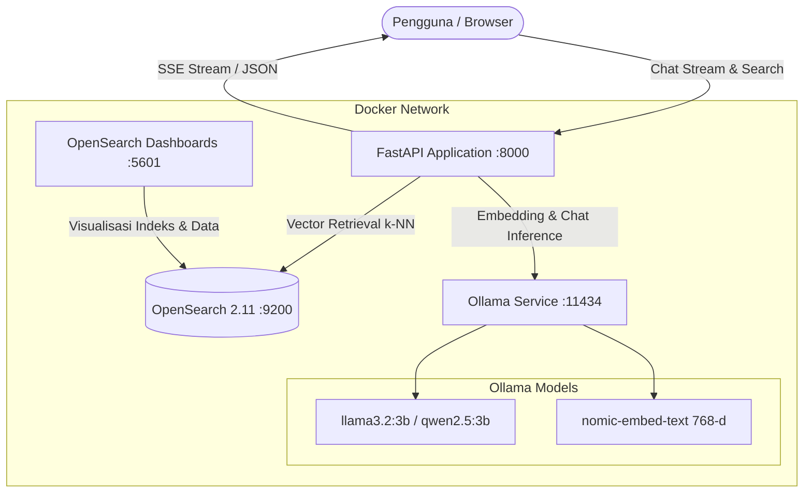

# 🔍 S.O.N.A.R — Social Online Network Analytics & Academic Response

<p align="center">
  
  
  
  
  
</p>

---

## 📖 Tentang Proyek

**S.O.N.A.R** adalah platform asisten cerdas berbasis **Retrieval-Augmented Generation (RAG)** yang mengintegrasikan:
1. **Ollama LLM** (`llama3.2:3b` / `qwen2.5:3b`) untuk inferensi bahasa alami secara streaming.
2. **OpenSearch 2.11** k-NN Vector Database (HNSW, Cosine Similarity) dengan embedding 768 dimensi via `nomic-embed-text`.
3. **Knowledge Base Terstandar** untuk dokumen SOP Akademik (SOP Cuti Akademik, SOP Pendaftaran KRS) dan dataset analitik sentimen publik.

Sistem telah disesuaikan secara menyeluruh dengan spesifikasi **Pertemuan 6** (Modul 10: Knowledge Base, Modul 11: Embedding Generation, dan Modul 12: Integrasi OpenSearch).

---

## ✨ Fitur Utama

- 🧠 **Vector Store k-NN Berkinerja Tinggi:** Menggunakan OpenSearch (algoritma HNSW) untuk pencarian dokumen semantik berbasis kemiripan makna (*semantic similarity*), bahkan tanpa adanya kesamaan kata kunci literal (*zero lexical overlap*).
- 🔄 **Resilient Dual-Backend Fallback:** Mendukung OpenSearch sebagai database vektor utama dengan fallback otomatis yang aman ke penyimpanan lokal (ChromaDB) jika diperlukan.
- 💬 **Modern Chatbot Web Interface:** Tampilan responsif dark-mode dengan dukungan SSE (*Server-Sent Events*) streaming token, auto-expand dock input, dan rendering Markdown.
- 📚 **Knowledge Base Multi-Format Ingestion:** Ekstraksi otomatis dokumen SOP berformat Markdown (`.md`), PDF (`.pdf`), dan Teks (`.txt`).
- 🐳 **Full Containerization:** Semua komponen (FastAPI, OpenSearch, OpenSearch Dashboards, Ollama) terorkestrasi secara terpadu melalui Docker Compose.

---

## 🏛️ Arsitektur Sistem



---

## 📁 Struktur Direktori

```text
├── app/
│   ├── embeddings.py          # Utilitas pembuatan vektor embedding nomic-embed-text (Modul 11)
│   ├── ingest.py              # Parser dokumen PDF/MD & ingestion pipeline (Modul 10 & 12)
│   ├── vector_store.py        # Klien abstraksi k-NN OpenSearch dengan HNSW (Modul 12)
│   └── main.py                # Backend FastAPI, REST API endpoints, & Chat Web Interface
├── knowledge-base/            # SOP Akademik Terstandar (Modul 10)
│   ├── sop-cuti-akademik.md   # Prosedur cuti akademik
│   └── sop-pendaftaran-krs.md # Prosedur KRS & formula beban SKS berdasarkan IPS
├── data/
│   └── social_media_comments.csv
├── tests/                     # Suite pengujian lengkap (88 automated test cases)
├── docker-compose.yml         # Konfigurasi container Ollama, OpenSearch, Dashboards, API
├── requirements.txt           # Dependensi pustaka Python
├── OPENSEARCH_RISK_ANALYSIS.md# Dokumen komprehensif analisis risiko penggunaan OpenSearch
└── README.md
```

---

## 🚀 Panduan Instalasi & Menjalankan (Docker)

Ikuti langkah-langkah mudah di bawah ini untuk menjalankan seluruh sistem langsung menggunakan Docker:

### 1. Prasyarat Sistem
- [Docker Desktop](https://www.docker.com/products/docker-desktop/) (dengan engine Linux container aktif).
- Disarankan alokasi RAM minimal 4 – 8 GB pada Docker Desktop.
- **Konfigurasi Kernel OpenSearch (Penting)**:
  OpenSearch membutuhkan nilai parameter virtual memory `vm.max_map_count` minimal `262144`.
  - **Untuk Windows (PowerShell/CMD)**:
    ```powershell
    wsl -d docker-desktop sysctl -w vm.max_map_count=262144
    ```
  - **Untuk Linux**:
    ```bash
    sudo sysctl -w vm.max_map_count=262144
    ```

---

### 2. Clone Repository
```bash
git clone https://github.com/Danzyyyy/S.O.N.A.R.git
cd S.O.N.A.R
```

---

### 3. Jalankan Docker Compose
Jalankan seluruh service di latar belakang:
```bash
docker compose up -d
```

Periksa status container:
```bash
docker compose ps
```
Pastikan seluruh service berstatus `Up` / `running`:
- `fastapi_app` (Port `8000`)
- `opensearch_node` (Port `9200`)
- `opensearch_dashboards` (Port `5601`)
- `ollama_service` (Port `11434`)

---

### 4. Unduh Model ke dalam Container Ollama
Jalankan perintah berikut untuk mengunduh model LLM dan embedding yang diperlukan:

```bash
# Model Embedding (wajib untuk pencarian semantik vektor 768 dimensi):
docker compose exec ollama ollama pull nomic-embed-text

# Model LLM Chat:
docker compose exec ollama ollama pull llama3.2:3b
```

---

### 5. Ingest Dokumen Knowledge Base ke OpenSearch
Jalankan skrip ingestion untuk membaca dokumen di `knowledge-base/`, membuat representasi vektor, dan mengindeksnya ke OpenSearch:

```bash
docker compose exec api python ingest.py
```

*Output yang diharapkan:*
```text
[INFO] Indeks 'knowledge-base' siap digunakan dengan pemetaan k-NN (HNSW).
[INFO] Membaca dokumen dari /app/knowledge-base...
[INFO] Berhasil mengindeks dokumen: sop-cuti-akademik.md
[INFO] Berhasil mengindeks dokumen: sop-pendaftaran-krs.md
[INFO] Ingestion selesai! Seluruh dokumen siap dicari secara semantik.
```

---

### 6. Akses Layanan

Buka browser Anda dan akses tautan berikut:

| Layanan | URL | Deskripsi |
| :--- | :--- | :--- |
| **Web Chatbot UI** | [http://localhost:8000](http://localhost:8000) | Antarmuka interaktif tanya jawab SOP akademik & analisis |
| **Swagger API Docs** | [http://localhost:8000/docs](http://localhost:8000/docs) | Dokumentasi OpenAPI & pengujian endpoint interaktif |
| **OpenSearch Cluster** | [http://localhost:9200](http://localhost:9200) | Endpoint REST & status kesehatan cluster OpenSearch |
| **OpenSearch Dashboards** | [http://localhost:5601](http://localhost:5601) | Antarmuka web visual untuk manajemen indeks OpenSearch |

---

## 🧪 Menjalankan Pengujian (Automated Tests)

Project ini dilengkapi dengan **88 test cases** (unit test, integrasi k-NN, batasan dimensi, dan adversarial test) untuk memastikan seluruh fitur berjalan tanpa error:

```bash
pytest -v
```

Hasil yang diharapkan:
```text
======================= 88 passed, 0 failed (100% LULUS) =======================
```

---

## ⚠️ Analisis Risiko Penggunaan OpenSearch

Kajian teknis mendalam mengenai perbandingan OpenSearch dengan vector database alternatif, kebutuhan memori/JVM heap, amplifikasi disk, serta kompleksitas operasional dapat dibaca pada dokumen resmi:
👉 **[Laporan Analisis Risiko OpenSearch (OPENSEARCH_RISK_ANALYSIS.md)](OPENSEARCH_RISK_ANALYSIS.md)**

---

## 🛠️ Troubleshooting Umum

1. **OpenSearch Container Exit / Crash on Startup**:
   - Periksa alokasi memori virtual kernel:
     `wsl -d docker-desktop sysctl -w vm.max_map_count=262144`
   - Pastikan Docker Desktop memiliki sisa memori RAM yang cukup.
2. **Kueri Chat Menghasilkan Jawaban Tanpa Konteks**:
   - Pastikan Anda sudah menjalankan langkah nomor 5 (`python ingest.py`) untuk memuat dokumen SOP ke dalam OpenSearch.
3. **Status Cluster OpenSearch Berwarna "Yellow"**:
   - Pada konfigurasi satu node (`discovery.type=single-node`), status yellow adalah kondisi normal karena tidak adanya node replica. Aplikasi dirancang untuk mengenali status ini secara aman.

---

## 📄 Lisensi
Didistribusikan untuk riset dan kebutuhan akademik sesuai ketentuan tugas.
