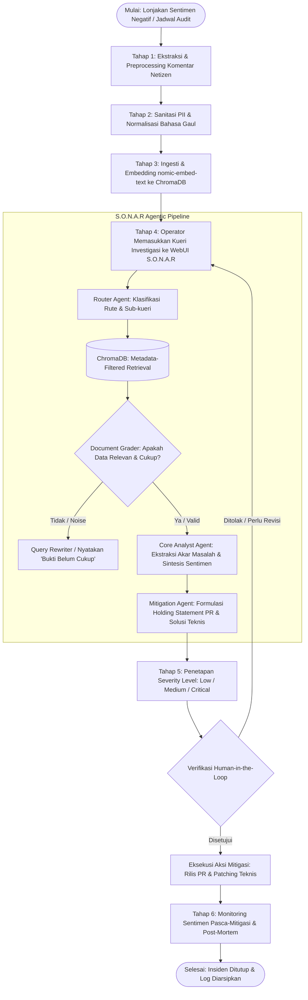

x# STANDAR OPERASIONAL PROSEDUR (SOP)
## INVESTIGASI AKAR MASALAH SENTIMEN PUBLIK DAN MITIGASI INSIDEN MEDIA SOSIAL BERBASIS AGENTIC RAG (S.O.N.A.R)

---

### LEMBAR KONTROL DOKUMEN

| Atribut | Informasi |
| :--- | :--- |
| **Nomor Dokumen** | **SOP/PDS-SONAR/2026/001** |
| **Judul Dokumen** | Standar Operasional Prosedur Operasionalisasi Sistem S.O.N.A.R untuk Root-Cause Analysis & Mitigasi Krisis |
| **Versi** | 1.0 |
| **Tanggal Efektif** | 27 Oktober 2026 |
| **Status Dokumen** | Dokumen Resmi / Disetujui |
| **Pemilik Proses** | Tim Pengembang S.O.N.A.R (Proyek Data Science) |
| **Sasaran Pengguna** | Data Science Team, DevOps/MLOps, Tim PR/Komunikasi Publik, Tim Customer Care, Tim Engineering |

---

## 1. TUJUAN
1. **Standardisasi Investigasi Insiden:** Memberikan panduan baku dalam memanfaatkan sistem **S.O.N.A.R** (*Social Online Network Analytics & Response*) untuk mengidentifikasi penyebab mendasar (*root cause*) dari lonjakan sentimen negatif publik di media sosial secara terukur dan empiris.
2. **Pencegahan Halusinasi & Jaminan Faktual:** Menjamin bahwa setiap analisis insiden dan formulasi respon didasarkan secara ketat (*grounded*) pada data keluhan riil netizen yang tersimpan dalam basis data vektor, dengan kontrol validasi ketat dari Document Grader.
3. **Efisiensi Kolaborasi Lintas Tim:** Mengintegrasikan tindak lanjut antara temuan akar masalah teknis (untuk tim *Product/Software Engineering*) dan formulasi komunikasi publik/klarifikasi (untuk tim *Public Relations* & *Customer Service*).
4. **Kepatuhan Privasi Data:** Memastikan operasionalisasi analitik mematuhi prinsip etika data dan anonimisasi data pribadi (PII - *Personally Identifiable Information*).

---

## 2. RUANG LINGKUP
SOP ini mencakup seluruh siklus operasional sistem S.O.N.A.R:
1. **Pengumpulan & Pra-pemrosesan Data:** Penarikan komentar publik dari kanal digital (Twitter/X, Instagram, TikTok, Google Play Store) dan tiket Customer Service.
2. **Ingesti Data Vektor:** Pembersihan data slang/noise, normalisasi teks, dan embedding ke ChromaDB.
3. **Eksekusi Investigasi Multi-Agent:** Operasionalisasi query melalui *Router Agent*, *Document Grader*, *Core Analyst Agent*, dan *Action & Mitigation Agent*.
4. **Penanganan & Eskalasi Krisis:** Matriks level keparahan (*Severity Level*) dan pembagian aksi mitigasi teknis serta *holding statement* PR.
5. **Evaluasi Pasca-Insiden & Pemeliharaan Model:** Audit grounding, pembaruan kamus bahasa gaul (*slang*), dan optimasi latensi sistem.

---

## 3. LANDASAN & KETENTUAN KHUSUS
1. **Prinsip Decision Support System (DSS):** Sistem S.O.N.A.R bertindak sebagai sistem pendukung keputusan cerdas dan **tidak menggantikan sepenuhnya otorisasi pengambil keputusan manusia** (Human-in-the-loop).
2. **Perlindungan Data Pribadi (UU PDP):** Seluruh data komentar publik yang diproses wajib melalui tahap *de-identification* (menghapus nomor rekening, nomor telepon, email, alamat, dan NIK).
3. **Infrastruktur Terisolasi (On-Premise / Local Inference):** Inferensi LLM dilakukan menggunakan model lokal (Llama 3.2 3B / Qwen 2.5 3B via Ollama) guna memastikan kerahasiaan data internal insiden.

---

## 4. PERAN DAN TANGGUNG JAWAB (RACI MATRIX)

| Peran / Jabatan | Tanggung Jawab Utama | RACI Status |
| :--- | :--- | :---: |
| **Project Lead & ML Engineer** | Mengelola runtime Docker, orkestrasi Agentic RAG, performa LLM Ollama, dan threshold Document Grader. | **A / R** |
| **Data Engineer** | Menjalankan pipeline ekstraksi data media sosial, normalisasi slang, sanitasi PII, dan skrip embedding ChromaDB. | **R** |
| **Data Scientist** | Memvalidasi kualitas dataset, skema metadata ChromaDB, evaluasi metrik retrieval (Precision@K), dan faithfulness audit. | **R** |
| **Data Analyst / UI Specialist** | Memantau dashboard sentimen, memfasilitasi interaksi query analis, dan menyusun laporan visualisasi berkala. | **R** |
| **Tim Public Relations (PR)** | Meninjau, memvalidasi, dan merilis draft *holding statement* hasil rekomendasi S.O.N.A.R ke kanal publik. | **C / I** |
| **Tim Engineering / Produk** | Menindaklanjuti rekomendasi teknis perbaikan bug, mitigasi timeout gateway pembayaran, atau rollback aplikasi. | **C / I** |
| **Tim Customer Care (CS)** | Menerapkan panduan skrip auto-reply dan memprioritaskan eskalasi tiket aduan pengguna berdasarkan pain point dominan. | **C / I** |

> *Keterangan: **R** = Responsible, **A** = Accountable, **C** = Consulted, **I** = Informed.*

---

## 5. DIAGRAM ALUR PROSES OPERASIONAL



---

## 6. PROSEDUR RINCI PELAKSANAAN

### 6.1. FASE 1: PERSIAPAN DATA DAN PEMELIHARAAN BASIS VEKTOR

1. **Jadwal Ingesti:** Dilakukan secara berkala (harian untuk monitoring rutin) atau seketika (*ad-hoc*) saat terjadi insiden lonjakan keluhan (>30% peningkatan volume komplain dalam 1 jam).
2. **Pembersihan & Pra-pemrosesan Data (Data Engineer):**
   - Lakukan filtering karakter non-standar, duplikasi bot/spam, dan noise teks.
   - Jalankan modul kamus normalisasi bahasa gaul/slang media sosial (contoh: *"lemot"* $\rightarrow$ *"lambat"*, *"error trs"* $\rightarrow$ *"selalu gagal"*).
   - Jalankan fungsi Regex anonymizer untuk menghapus data sensitif (PII: nomor kartu, nama lengkap nasabah, nomor telepon).
3. **Eksekusi Embedding & Metadata Tagging (ML & Data Engineer):**
   - Format data ke dalam skema metadata standar:
     ```json
     {
       "source": "twitter | playstore | instagram | cs_ticket",
       "category": "qris | app_v2.4 | customer_service | general",
       "sentiment": "positive | neutral | negative",
       "timestamp": "YYYY-MM-DDTHH:MM:SSZ",
       "engagement_score": 120
     }
     ```
   - Jalankan pipeline `python ingest.py` untuk mengonversi teks menggunakan model `nomic-embed-text` ke koleksi ChromaDB.
   - Verifikasi bahwa vector store aktif dan dapat diakses pada port target.

---

### 6.2. FASE 2: MEMULAI INVESTIGASI PADA ANTARMUKA S.O.N.A.R

1. **Pengecekan Kesiapan Layanan (Operator / Analyst):**
   - Pastikan Docker container berjalan normal:
     ```bash
     docker compose ps
     ```
   - Pastikan service `ollama` (dengan model `llama3.2:3b` atau `qwen2.5:3b`), `chromadb`, dan `api` berstatus *Up/Healthy*.
2. **Akses Antarmuka:** Buka peramban dan navigasikan ke `http://localhost:8000` (atau URL server operasional S.O.N.A.R).
3. **Pemilihan Model LLM:**
   - Gunakan **Meta Llama 3.2 (3B)** untuk penalaran analitis mendalam dan perumusan mitigasi strategis.
   - Gunakan **Qwen 2.5 (3B)** untuk analisis dengan kecepatan tinggi (*low-latency*) atau jika menangani variasi linguistik campuran.
4. **Input Kueri Investigasi:**
   - Masukkan pertanyaan spesifik berbasis insiden.
   - *Contoh Kueri Baik:*
     - *"Analisis penyebab lonjakan keluhan transaksi QRIS gagal/timeout pada tanggal 25-27 Oktober dan petakan sentimen pengguna."*
     - *"Apa akar masalah rating bintang 1 pada update aplikasi versi v2.4 di Google Play Store?"*
     - *"Berapa proporsi keluhan terkait lamanya respon Customer Service dan apa pola aduan terbesarnya?"*

---

### 6.3. FASE 3: PENGAWALAN PROSES MULTI-AGENT & ANTI-HALUSINASI

Operator wajib memantau indikator alur penalaran sistem:

1. **Router Agent:**
   - Memastikan kueri masuk ke kategori `"VECTORSTORE"` untuk analisis internal insiden.
   - Jika sistem salah mendeteksi sebagai `"DIRECT_CHAT"` padahal membutuhkan data komplain, perbaiki format prompt kueri agar memuat kata kunci insiden.
2. **Document Relevance Grader (Tahap Kritis Anti-Halusinasi):**
   - Sistem memvalidasi apakah dokumen komentar yang terambil dari ChromaDB memiliki keterkaitan langsung dengan kueri.
   - **Aturan Tegas:** Jika dokumen tidak memadai (`is_relevant: "no"`), sistem **dilarang menyimpulkan secara spekulatif**. Sistem wajib menampilkan pesan standar:
     > *"Bukti komentar media sosial pada basis data belum mencukupi untuk menarik kesimpulan akar masalah secara valid. Silakan lakukan pembaruan data ingesti atau spesifikasikan rentang waktu kueri."*
3. **Core Social Media Analyst:**
   - Menghasilkan ringkasan berstruktur:
     - 📊 **Ringkasan Situasi & Sentimen** (Proporsi sentimen dan polaritas umum).
     - 🔍 **Akar Permasalahan (Root Cause)** (Analisis kegagalan sistemik/teknis/layanan).
     - 🗣️ **Suara Netizen** (Kutipan komentar representatif sebagai bukti empiris).
     - 📈 **Tren & Dampak** (Potensi risiko reputasi brand).
4. **Action & Mitigation Agent:**
   - Mengeluarkan skor risiko, draf komunikasi resmi, dan rekomendasi aksi teknis.

---

### 6.4. FASE 4: KLASIFIKASI TINGKAT KRISIS (SEVERITY LEVEL)

Tim mengklasifikasikan insiden ke dalam salah satu tingkatan berikut berdasarkan luaran S.O.N.A.R:

| Level Krisis | Kriteria & Indikator Sentimen | Tindakan & Waktu Tanggap (SLA) |
| :---: | :--- | :--- |
| **Level 1 (Low)** | • Sentimen negatif < 25% dari total volume harian.<br>• Keluhan bersifat sporadis, non-sistemik (bukan core service). | • Evaluasi rutin mingguan.<br>• Respon standar CS dalam SLA 2-4 jam.<br>• Pencatatan backlog perbaikan aplikasi. |
| **Level 2 (Medium)** | • Sentimen negatif 25% - 50% dalam 3 jam terakhir.<br>• Bug pada fitur minor rilis v2.4 atau perlambatan respons CS. | • Penyelidikan teknis dalam SLA < 2 jam.<br>• Pemantauan intensif di antarmuka S.O.N.A.R per 30 menit.<br>• Penyiapan draft FAQ antisipatif untuk tim CS. |
| **Level 3 (Critical)** | • Sentimen negatif > 50% atau volume komplain melonjak >100% dalam 1 jam.<br>• Insiden layanan inti (misal: Transaksi QRIS gagal massal namun saldo terpotong).<br>• Menjadi trending topic negatif di platform media sosial. | • **Aktivasi War Room Krisis segera (< 15 menit).**<br>• Rilis *Holding Statement* resmi dalam SLA < 30 menit.<br>• Tindakan darurat teknis (Rollback / Failover gateway). |

---

### 6.5. FASE 5: DISTRIBUSI DAN EKSEKUSI MITIGASI (HUMAN-IN-THE-LOOP)

1. **Untuk Tim Public Relations / Komunikasi Publik:**
   - Ambil draf *Holding Statement* dari output S.O.N.A.R.
   - Lakukan review manusia terhadap tone kalimat (empati, transparan, tidak menyalahkan pihak ketiga secara gegabah).
   - Publikasikan melalui kanal resmi (Twitter/X, broadcast in-app notification, IG story resmi).
   - Perbarui status penanganan secara berkala sesuai batas waktu eskalasi yang disarankan sistem.
2. **Untuk Tim Engineering / Produk:**
   - Validasi daftar *Action Items Teknis* dari output S.O.N.A.R terhadap telemetry server/APM (Application Performance Monitoring).
   - Lakukan tindakan perbaikan (misal: restart pod gateway, koordinasi dengan payment provider, atau rilis patch darurat v2.4.1).
3. **Untuk Tim Customer Care / Support:**
   - Distribusikan temuan *Pain Points* utama ke seluruh agent CS.
   - Perbarui pesan template respon cepat (*canned response*) di WhatsApp / LiveChat sesuai draf S.O.N.A.R agar informasi yang disampaikan seragam (*one-voice policy*).

---

### 6.6. FASE 6: MONITORING PASCA-MITIGASI DAN PENUTUPAN INSIDEN

1. **Tracking Pemulihan Sentimen:**
   - Lakukan kueri berkala ke S.O.N.A.R setiap 30 menit pasca-rilis pernyataan resmi dan perbaikan teknis.
   - Status krisis dinyatakan **Selesai (Closed)** apabila rasio sentimen netral/positif kembali berada di atas **80%** dan volume komplain baru kembali ke batas baseline normal.
2. **Penyusunan Laporan Post-Mortem:**
   - Export riwayat percakapan investigasi dari antarmuka S.O.N.A.R.
   - Lengkapi formulir *Incident Post-Mortem Report* (Lampiran 1).
3. **Audit Akurasi Model & Grounding:**
   - Data Scientist dan ML Engineer melakukan review:
     - Apakah kesimpulan Core Analyst akurat dan terbukti di lapangan?
     - Apakah ada komentar slang baru yang gagal dipahami embedding? Jika ada, daftarkan kata baru ke kamus normalisasi data pipeline.

---

## 7. MONITORING DAN AUDIT SISTEM

Untuk menjaga keandalan operasional S.O.N.A.R, tim wajib melakukan pemeliharaan berkala:

1. **Audit Faithfulness & Groundedness (Bulanan):**
   - Ambil 50 sampel acak respons S.O.N.A.R.
   - Evaluasi skor keselarasan antara konteks dokumen yang ditarik dengan narasi yang digenerasi oleh LLM. Skor minimal toleransi adalah **95% bebas halusinasi**.
2. **Optimasi Latensi & Kapasitas (Kuartalan):**
   - Pantau latensi First-Token Latency (FTL) pada SSE streaming (target < 2 detik pada GPU/CPU terkonfigurasi).
   - Lakukan *pruning* atau pengarsipan koleksi vektor ChromaDB untuk data komplain yang telah berusia lebih dari 12 bulan jika kapasitas penyimpanan mendekati batas threshold server.

---

## 8. LAMPIRAN

### Lampiran 1: Template Formulir Laporan Insiden (Incident Post-Mortem Report)

```text
================================================================================
LAPORAN INVESTIGASI INSIDEN SENTIMEN MEDIA SOSIAL — S.O.N.A.R
================================================================================
ID Laporan          : INC-[YYYYMMDD]-[NOMOR]
Tanggal Kejadian    : DD MMMM YYYY
Penyusun Laporan    : [Nama Operator / Analis]
Topik Insiden       : [QRIS_TRANSACTION / APP_UPDATE / CUSTOMER_SERVICE / OTHER]
Level Keparahan     : [LEVEL 1 - LOW / LEVEL 2 - MEDIUM / LEVEL 3 - CRITICAL]
Model LLM Digunakan : [Meta Llama 3.2 3B / Qwen 2.5 3B]

1. KRONOLOGI INSIDEN:
   - Waktu Deteksi Pertama : HH:MM WIB
   - Kanal Utama Terimbas  : [Twitter / Play Store / Instagram / CS]
   - Volume Aduan Puncak   : [Jumlah komentar/menit]

2. HASIL ANALISIS ROOT-CAUSE (S.O.N.A.R):
   - Ringkasan Sentimen   : [% Negatif / % Netral / % Positif]
   - Akar Masalah Utama   : [Uraian penyebab kegagalan sistem/layanan]
   - Representasi Bukti   : "[Kutipan keluhan riil netizen dari ChromaDB]"

3. TINDAK LANJUT MITIGASI:
   - Tindakan Teknis      : [Patching / Rollback / Server Scaling]
   - Holding Statement PR : "[Teks klarifikasi yang telah dirilis ke publik]"
   - Waktu Rilis Respon   : HH:MM WIB (Durasi tanggap: XX Menit)

4. EVALUASI DAN REKOMENDASI PREVENTIF:
   - Waktu Normalisasi     : HH:MM WIB
   - Evaluasi Grounding AI : [Akurat / Sebagian Halusinasi / Perlu Peningkatan Kamus]
   - Tindakan Preventif    : [Langkah perbaikan sistem jangka panjang]
================================================================================
```

---
*Dokumen ini diterbitkan oleh Tim Pengembang S.O.N.A.R untuk menjamin operasional analitik data science yang akuntabel, etis, dan solutif.*
